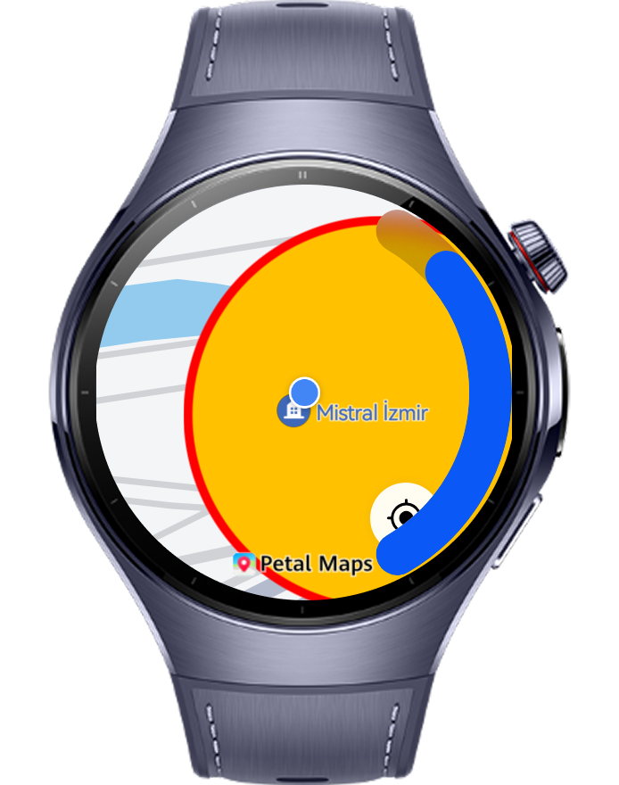
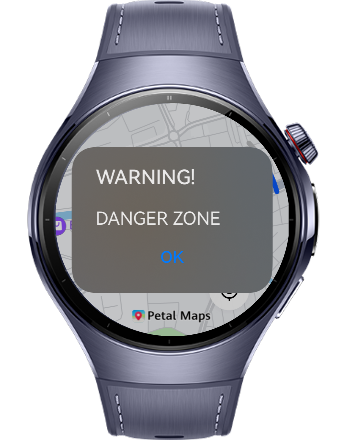

> **Note:** To access all shared projects, get information about environment setup, and view other guides, please visit [Explore-In-HMOS Index](https://github.com/Explore-In-HMOS/hmos-index).

# Safe Circle

SafeCircle is a geofencing-based application that alerts users with a notification when they move away from their current location.

# Preview

<div>
  
  
  
</div>

# Use Cases

1. Users can start the application and see their current location and safe area.
2. If users walk through out the safe zone, application gives notification alerts with vibration

# Technology

## Stack

- **Languages**: ArkTS, ArkUI
- **Frameworks**: HarmonyOS 5.1.0(18)
- **Tools**: DevEco Studio Vers 5.1.0.828SP1,
- **Libraries**: @kit.ArkUI, @kit.NetworkKit, @kit.MapKit, @kit.NotificationKit, @kit.LocationKit, @ohos.vibrator

## Required Permissions

- `ohos.permission.LOCATION`
  > Required to get location information.
- `ohos.permission.APPROXIMATELY_LOCATION`
  > Required to get approximate location.
- `ohos.permission.LOCATION_IN_BACKGROUND`
  > Required to use location services in background
- `ohos.permission.VIBRATE`
  >Required to use vibration

# Directory Structure

```
entry/src/main/ets/
├───entryability
│       EntryAbility.ets
├───entrybackupability
│       EntryBackupAbility.ets
├───pages
│       Index.ets
└───services
        LocationService
```

# Constraints and Restrictions

## Suported Devices

- Huawei Watch 5

## Limitations

- Safe Circle is not working on previewer or simulators
- Users need to apply location permissions and enable location in smart watch

# License

**Safe Circle** is distributed under the terms of the MIT License
See the [LICENSE](/LICENSE) for more information.